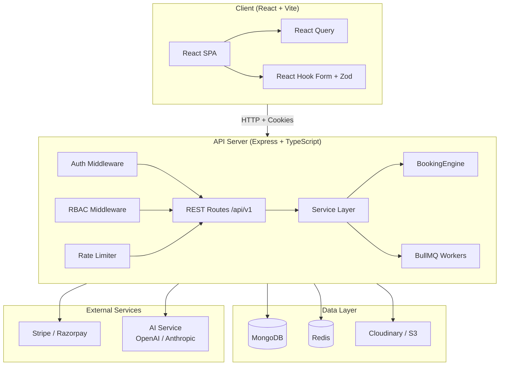

# RentalHub Architecture

## System Overview

RentalHub is a full-stack equipment rental platform built as a monorepo with a React (Vite) frontend and an Express (Node.js) backend, connected to MongoDB and Redis.

## Architecture Diagram



## Key Design Decisions

### 1. Booking Engine (Centralized)
- Single `BookingEngine` service is the **only** path to create/modify bookings.
- MongoDB transactions + compound index `{equipmentId, startDate, endDate, status}` prevent double bookings.
- Soft-lock (hold) for 10 minutes during checkout, auto-released by TTL index.
- Idempotency keys on booking/payment endpoints.

### 2. Authentication & Authorization
- JWT access token (15 min) + refresh token (7 days) in httpOnly cookies.
- RBAC with three roles: `customer`, `owner`, `admin`.
- Refresh token rotation on each use.

### 3. Database Design
- MongoDB with Mongoose ODM.
- Compound indexes for overlap checks, geospatial index for location search.
- Text index for full-text search.
- TTL index for expired holds and stale notifications.
- Soft deletes (`deletedAt`) on all entities.

### 4. Real-time
- Socket.IO for availability updates, booking status changes, and notifications.

### 5. Background Jobs
- BullMQ + Redis for reminders, late-return checks, pricing recalculation, and health-score updates.

### 6. AI Integration
- Pluggable service layer with rule-based fallback.
- All AI outputs include confidence scores and human-readable reasoning.
- AI never makes final decisions on money or blame — it proposes, humans confirm.

## Folder Structure

```
rentalhub/
├── docker-compose.yml
├── docs/
│   ├── architecture.md
│   └── er-diagram.md
├── server/                 # Express + TypeScript API
│   ├── src/
│   │   ├── config/         # env, db, logger
│   │   ├── models/         # Mongoose schemas
│   │   ├── middleware/     # auth, rbac, validate, errorHandler
│   │   ├── routes/         # REST routes
│   │   ├── controllers/    # Request handlers
│   │   ├── services/       # Business logic
│   │   ├── utils/          # Helpers
│   │   └── seed/           # Demo data
│   └── tests/              # Jest + Supertest
├── client/                 # React + Vite SPA
│   └── src/
│       ├── components/
│       ├── pages/
│       ├── lib/            # API client
│       └── hooks/
└── .github/workflows/      # CI
```
